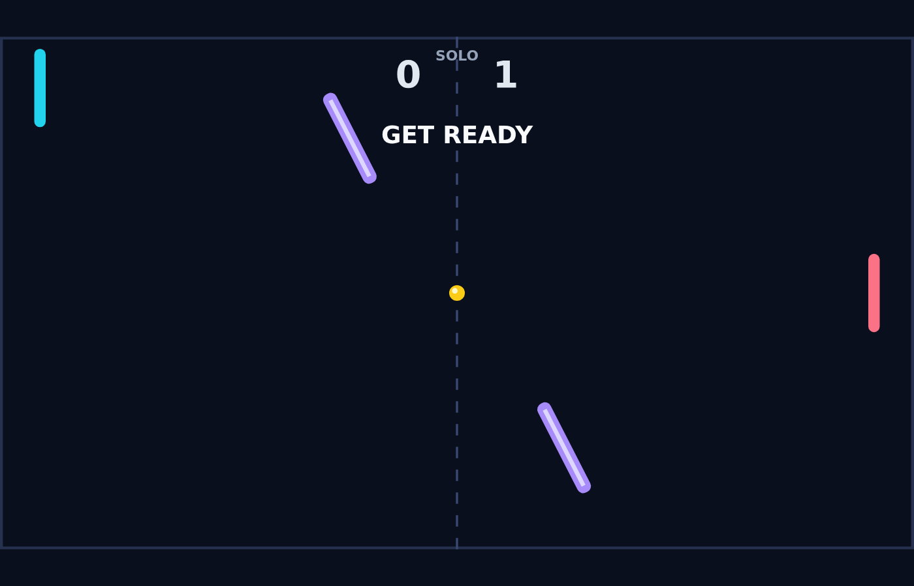

Carom is a fast, top-down paddle duel for two players — or one player against a sharp AI. Two bright paddles face off across a dark field while a glowing ball ricochets between them, caroming off the top and bottom walls and through a pair of violet obstacles that never sit still.

Every rally begins with a short hold and a serve toward the player who just conceded, then quickly becomes a duel of angles. Where the ball meets your paddle decides its return angle, every paddle hit makes it a little faster, and the first player to 11 points — with a lead of at least two — takes the match.

Carom's signature is spin. Strike the ball while your paddle is moving and the ball curves in flight, bending around an obstacle or curling away from your opponent's reach before the spin fades. A paddle held still plays it straight; a paddle sweeping downward sends the shot arcing the other way.

The two obstacles sway in opposite rhythm and spin in place, turning the middle of the field into a bank-shot puzzle. A shot that looks blocked can glance off a tilted obstacle into open space, and a safe return can be turned back at a cruel angle. Learn to use them, and the field itself becomes your second paddle.
